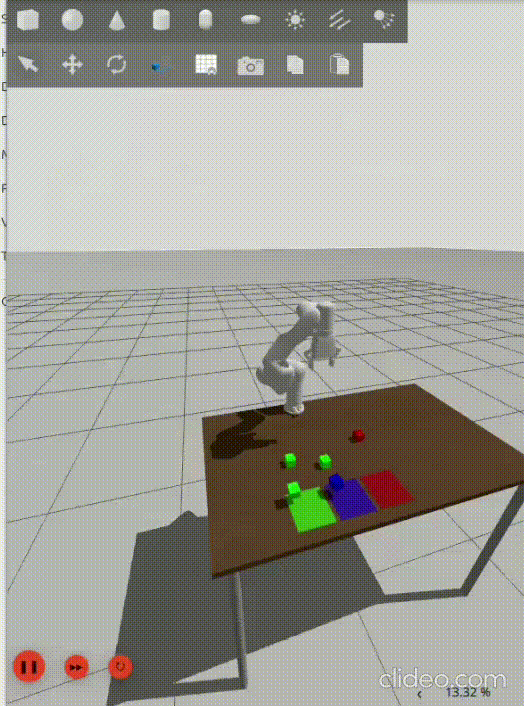

# Robotic arm cube solver

This project implements an autonomous cube sorting system using a UFactory xArm7 robotic arm in a ROS 2 and Gazebo simulation environment.

The camera detects cubes using computer vision, identifies their positions, colors and performs pick-and-place operations to sort them in the right color square.

This project was developed in ROS 2 and simulated in Gazebo.

## Features 
- Movement planning using MoveIt2
- Cartesian pick-and-place movements
- Cube detection using OpenCV
- Automated cube sorting

## Technologies used
- Ubuntu 24.04
- ROS 2 
- Gazebo
- MoveIt 2
- Python

## The process

I started by figuring out how could I get the robot to the work surface. Then, I had to figure out how could I detect the cubes, their positions and color. After that, I had to make moving phases for the robot(go down, pick up, go up and go the right square).

I also had to detect the color of the surface. The positions of the surfaces were always fixed, but the colors were never the same. For this obstacle I used openCV. 

I implemented 5 nodes for this project :
  - ***auto_scan*** -> This node brings the robotic arm to the working surface. The robot stops moving when it detects all of the cubes.
  - ***cube_detector*** -> This node detects the position and the color of the cubes.
  - ***surface_detector*** -> This node detects the color of the surface.
  - ***closest_cube*** -> This node gives us information about the closest cube to the base of the robot.
  - ***move_to_cube*** -> This node would be our sorting logic. It gets information from other nodes such as the closest cube to the base of the robot, cube colors, cube coordinates and surface color.

One of the challenges was implementing MoveIt2 to the code. The code isn't ideal because there are occasions that the robot couldn't calculate the movement, but that's why I implemented multiple re-try plans. 

## What I learned

- Using ROS2 framework
- openCV
- Transformations
- Node communications

## How can it be improved

- Using less nodes
- Improving the movement of the robot
- Preventing complicated movement
- Code quality

## Video

<p align="center">
  
</p>


## Installation

### 1. Clone the repo
```bash
git clone --recurse-submodules https://github.com/Szaborobert5/ROS2-xArm7-robotic-arm-cube-solver.git

cd ROS2-xArm7-robotic-arm-cube-solver
```

### 2. Source ROS2
```bash
source /opt/ros/jazzy/setup.bash
```


### 3. Install dependencies

```bash
sudo apt update

sudo rosdep init
rosdep update

rosdep install --from-paths src --ignore-src -r -y
```

### 4. Build the workspace

```bash
colcon build
```

### 5. Source the workspace

```bash
source install/setup.bash
```
### 6. Run the program

```bash
ros2 launch project_2026 task.launch.py
```
Three nodes should start : closest_cube.py, cube_detector.py, surface_detector.py

Run two more nodes :

```bash
ros2 run project_2026 auto_scan
ros2 run project_2026 move_to_cube
```
